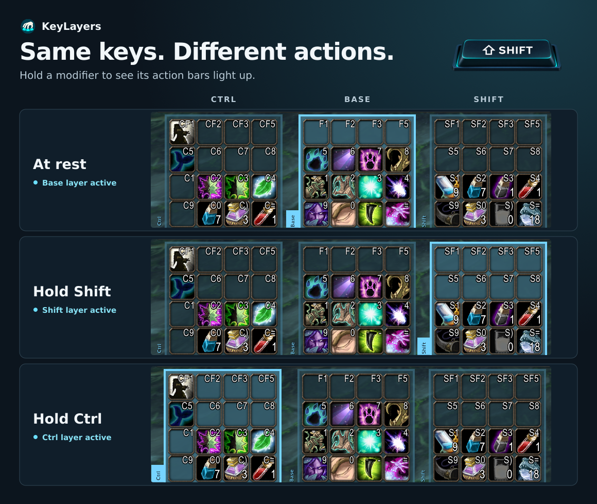
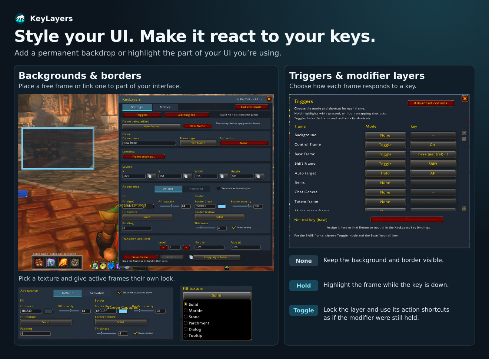
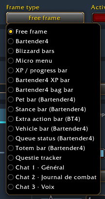
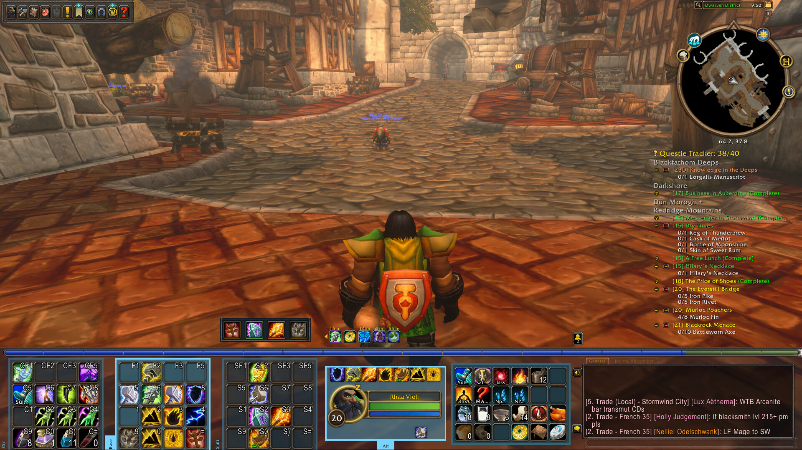

# KeyLayers by Rav Yoli 1.1.14b

**KeyLayers** is a keyboard-first addon for **WoW Forever**. It organizes your keybinds into layers and highlights the action bars for the layer you’re using.

I designed and tuned KeyLayers to work smoothly with **Bartender4**, and it also works with WoW’s built-in interface on its own. Link a frame to one or more action bars or another supported UI element, and its background and border automatically fit and follow that element.

## Why I built KeyLayers

I wanted to save time and play WoW entirely from the keyboard. The idea is to control as many actions as possible with as few fingers as possible, so I can keep my eyes on what’s happening around my character. With layers like **Base**, **Ctrl**, and **Shift**, the same key can do different things. The highlighted frames show me which layer I’m on at a glance.

## Gaming keypads and the keyboard

I built KeyLayers around my **Azeron Cyborg** to reach more abilities with less hand movement. The same approach works with a **Keyzen**, a **Razer Tartarus**, or a regular keyboard. See the [gaming keypad setup guide](docs/GAMEPAD.md) for my Azeron button map and how I use the mouse thumb buttons to switch layers.

## Project origins and transparency

KeyLayers grew out of my earlier project, **BMF Modifier Glow**. Thanks to **Darkspore** for inspiring the frame customization features with [Backdrops Maker Forever](https://www.curseforge.com/wow/addons/backdrops-maker-forever).

The project was originally called **BartenderGlow** and started as a way to decorate Bartender4 action bars with custom backgrounds and borders. It has since grown into **KeyLayers**, a standalone addon that also works with WoW’s built-in action bars. Bartender4 is an optional integration. KeyLayers automatically migrates settings saved under the old `BartenderGlow` names.

KeyLayers was built with **GPT‑6.2**. My role as **Rav Yoli** was to define the product vision. It took about two days to pin down what I wanted and refine the prompts, plus lots of in-game testing to get to this version.

## Supported languages

- English
- French (`frFR`)
- German (`deDE`)
- Spanish, Spain and Latin America (`esES`, `esMX`)
- Simplified Chinese (`zhCN`)
- Traditional Chinese (`zhTW`)

**Only English and French have been tested.** English is the fallback for other game languages.

## Installation

Extract the `KeyLayers by Rav Yoli` folder into `Interface/AddOns`. Launch WoW, enable **KeyLayers by Rav Yoli**, then open it with `/keylayers` or the minimap icon. Bartender4, Questie, and SexyMap are optional. In SexyMap, open **Buttons > Addon buttons > KeyLayers** to set minimap button visibility.

## Frames that fit your UI automatically

Under **Frame type**, pick what you want to style. KeyLayers fits the background and border to the visible elements and follows them when you move or resize them. You can group several action bars under one frame, so you only have to style them once. For linked frames, use **Padding** to adjust the space around the elements.

| What you want to style | Frame type |
| --- | --- |
| Bartender4 action bars | **Bartender4**. Group numbered bars, class bars (**C1–C4**), and the bonus action bar (**B+**) in the same frame. |
| Other Bartender4 bars | Dedicated types for XP, bags, pet, stance, extra action, vehicle, queue status, and totem bars. |
| WoW’s built-in interface | **Blizzard bars** for one or more action bars, **Micro menu** for the Character, Talents, and other menu buttons, and **XP / progress bar** for the native progress bar. **Micro menu** also follows the buttons when Bartender4 moves them. |
| Chat and quests | Choose a **Chat** window, **Glass chat** for the main Glass Forever window, or **Questie tracker** for Questie's quest list. |
| Any spot on the screen | **Free frame**. Set its position and size yourself. |

For action bars, select the bar numbers under **Layout**, or click their badges in **Edit mode**. The main Blizzard action bar is number 1. Existing Bartender4 frames keep their bar links.

### Integration examples

#### Choosing a UI element to frame

Open **Frame type** and choose the element you want to style. For example, select **Bartender4 bag bar** and KeyLayers will fit your background and border around the bag buttons and follow them when you move the bar.

## Your first frame

1. Open **Settings** and click **New frame**.
2. Pick **Bartender4** or **Blizzard bars**, then select the action bars you want to frame. Try bars 4 and 5.
3. Open **Activation** and choose **Hold** with **Shift** as the key. Click **Save frame**.
4. Use **Learning tab** to show the **Shift** label even when the frame is inactive.
5. Move or resize one of the linked bars. The frame follows its visible buttons. If all linked bars are hidden, the frame hides too.

Choose **Free frame** for a standalone backdrop. **X** and **Y** are offsets from the center of the screen. A frame with **None** as its trigger stays visible. Colors use hex codes, opacity uses percentages, and durations are in seconds.

## Edit mode

Click **Edit mode** to show your frames on screen. Click a frame to open its settings in the same window. **New frame** opens Edit mode with a free frame. Drag it to move it, or drag the handle in the bottom-right corner to resize it. The position and size fields update as you go.

**Fill texture** and **Border texture** use WoW’s built-in artwork. Try **Marble** or **Parchment** for the fill and **Gold dialog** or **Chat bubble** for the border. The selected frame previews your changes as you make them while **Settings** is open, even outside Edit mode. Closing the window or switching to **Profiles** ends the preview. Click **Save frame** to apply your changes before selecting another frame.

To reposition a linked frame, move the bars it follows. In Edit mode, each visible Bartender4 bar shows its number over its buttons. Click a bar number to add it to the selected frame, or click it again to remove it.

## Colors and styles

Click the swatch beside a hex code to open WoW’s color picker. You can also type the code directly. The sliders set fill and border opacity. Set the thickness for solid borders, or let KeyLayers pick it for textured borders. The **−** and **+** buttons change the level by one.

For the fill, pick **Solid** to set a color, or choose a texture to use its original colors. Opacity applies to both. KeyLayers remembers your solid color when you switch back.

In **Appearance**, use **Default** to set your usual colors and opacities. Turn on **Separate activated style** to customize how the frame looks when active. To hide the default style, set both of its opacities to zero. **Copy style from…** copies another frame’s style into the selected tab.

With a single style, the frame’s fill and border appear while its trigger is active. A frame with **None** as its trigger stays visible. The learning tab can stay visible when the frame is inactive.

## Learning tabs

**Learning tab** sets the global visibility, orientation, and position. To customize a single frame, open **Frame settings…**, turn on **Override global settings**, and save the frame. Older per-frame settings carry over as overrides.

Choose a horizontal or vertical tab and place it above, below, or on either side of the frame. **Place tab** shows twelve positions around the frame. The tab starts at the top left by default, and vertical text rotates 90° counterclockwise.

You can preview the tab on the selected frame in Edit mode. When the frame uses a textured border, the tab takes on that style. When the frame is inactive, the tab’s background becomes transparent and its text takes on the displayed style’s border color. Turn off **Show tab** globally to hide every learning tab, or turn it off in a frame’s settings to hide just that one.

## Profiles

Save and load named setups from **Profiles**. The list is shared across characters on the same account. Free frames restore their saved positions and dimensions. Linked frames restore their bar numbers, then fit the bars as they’re laid out on the current character. The profiles in this version are specific to KeyLayers.

A profile includes your saved frames, triggers, styles, learning-tab settings, minimap icon position, and neutral key. If that key is already in use, KeyLayers keeps the current neutral key and tells you after loading. Older profiles keep the current minimap position and neutral key when those settings are missing.

Save the frame you’re editing before saving the profile.

### ProfileSync

On the source character, open **ProfileSync > Options** and enable character data for **KeyLayers by Rav Yoli**. If the entry is missing after updating, run `/ps scan`. Save a setup and apply it on the destination character.

Enable **Key bindings** in ProfileSync to copy regular WoW bindings and the Neutral key. KeyLayers restores missing custom frame Toggle shortcuts from the layout if their keys are free.

## Chat windows

Under **Frame type**, pick **Chat 1**, **Chat 2**, or another existing chat window. The menu also shows its in-game name.

Create one frame per detached chat window. The frame follows the window’s position, size, and visibility. When several tabs share one window, the style is shown for the visible tab.

## Stacking

**Level** uses the same scale for free frames, Bartender4 frames, and chat frames. A higher level places the styling in front of lower-level KeyLayers frames. Action buttons and chat text stay above their own styling.

## Copying position and size

Under **Layout** for a free frame, click the copy icon next to **X**, **Y**, **Width**, or **Height**. Pick the source frame and repeat for each value you want. Frames linked to Bartender4 or chat can be sources while they’re visible. Save the free frame to keep the copied values.

## Triggers

Open **Triggers** to configure **Hold** and **Toggle** independently for each frame. Confirm any shortcut reassignment after reviewing its current assignment. KeyLayers supports **Ctrl**, **Shift**, and **Alt**, on their own or in combinations such as **Ctrl + Shift**, **Ctrl + Alt**, or **Ctrl + Shift + Alt**.

- **None** keeps the frame visible.
- **Hold** highlights the frame while you hold the modifier. This is handy for a modifier you already use elsewhere, such as Alt for self-cast.
- **Toggle** uses a **Dedicated shortcut** to lock a layer and redirect its action keybinds. For example, assign F8 to Ctrl + Shift. Press F8 again to unlock.

Changes apply right away to saved frames. For a new frame, click **Save frame** after choosing its mode.

Physical modifiers keep their Hold behavior while a layer is locked. Assign dedicated shortcuts to existing Toggle frames after updating.

For your base frame, choose **Toggle → Base (neutral)**. Base is active at startup when no modifier is held and no layer is locked. Assign an unused key under **Neutral key (Base)**, or find **Return to neutral** under WoW’s **Options → Keybindings → KeyLayers**.

### Example: Alt for self-cast

Alt is commonly used as WoW’s **Self Cast Key**. With that setting, hold Alt while casting an eligible spell to cast it on yourself and keep your current target. In KeyLayers, assign **Alt** in **Hold** mode to highlight a frame while the key is down.

A **Hold** key can work alongside a toggle layer. For example, with Ctrl locked, hold Alt and press 2. If Alt+Ctrl+2 is bound to an action button, it takes priority. Otherwise, KeyLayers uses the Ctrl+2 button with Alt still held. WoW’s saved keybinds stay intact.

Use `/keylayers diagnostic` to see the current layer and how many action keybinds KeyLayers detects for each toggle.

**Avoid Alt+F4.** Your system can close the game when you use that combination, and KeyLayers can’t intercept it.
