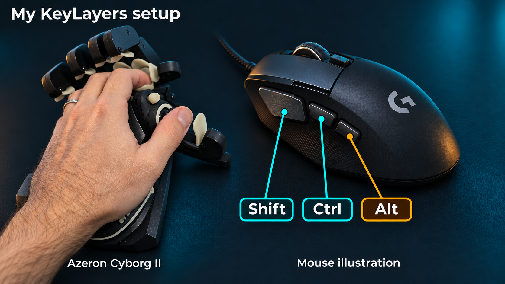
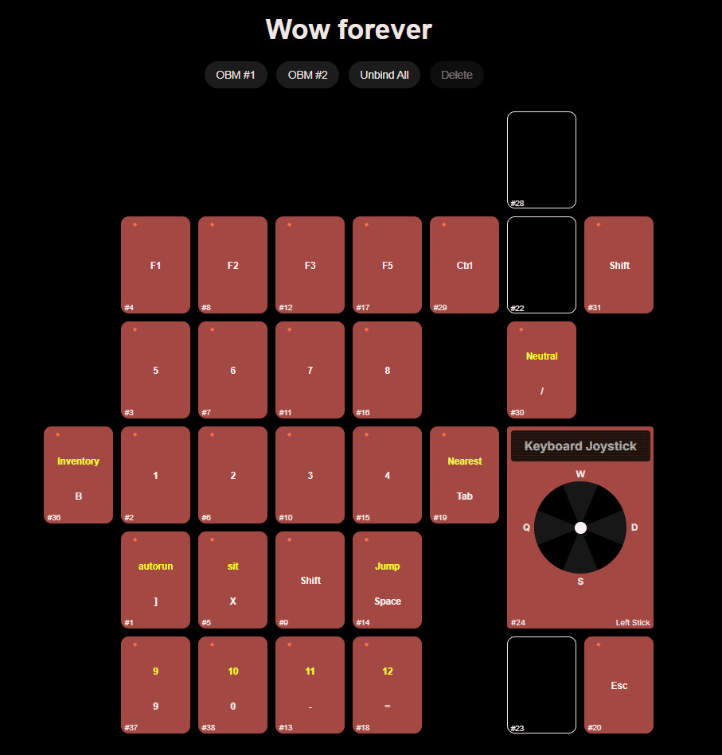

# KeyLayers gaming keypad setup

I use KeyLayers in **WoW Forever** with an **Azeron Cyborg II** in my left hand and a mouse in my right. My left hand stays on the same buttons. My right thumb switches which set of abilities those buttons trigger. A **Keyzen**, **Razer Tartarus**, or regular keyboard can use the same approach with keys that are comfortable to reach.

## Mouse thumb buttons

My left hand on the tilted Azeron and a right-handed mouse illustration with Shift, Ctrl, and Alt callouts

On my mouse, the three thumb buttons are mapped to **Alt**, **Ctrl**, and **Shift**, in that order from the button closest to me to the front of the mouse.

| Input | Mode | How I use it |
| --- | --- | --- |
| **Alt** | **Hold** | Highlights my character frame while I use WoW’s **Self Cast Key** to cast on myself and keep my current target. |
| **Ctrl** | **Toggle** | Switches to my Ctrl layer and keeps its bars highlighted after I release the button. |
| **Shift** | **Toggle** | Switches to my Shift layer so the same Cyborg buttons can trigger a different set of abilities. |
| **/** on the Cyborg | **Return to neutral** | Returns to **Base** from either toggle layer. |

Set the mouse buttons to send those modifier keys in your mouse software. Then open **Triggers** in KeyLayers and assign the corresponding mode and modifier to each frame. The Alt example assumes **Alt** is also configured as WoW’s **Self Cast Key**.

## My Azeron button map

- **Action keys** sit on the finger buttons. The map shows **1–8** and **F1**, **F2**, **F3**, **F5** in the main cluster, with **9**, **0**, **-**, and **=** on the lower row.
- **Movement** is on the thumbstick, which sends keyboard inputs **W**, **Q**, **S**, and **D** in my layout.
- **Everyday controls** stay within reach, including **Tab** for the nearest target, **Space** for jumping, **B** for inventory, and **/** to return to Base.

> **Why I skip F4** — I deliberately leave **F4** unbound on my Cyborg. On Windows, **Alt + F4** closes the active window, so skipping F4 keeps me from accidentally closing WoW while holding Alt to self-cast.

Try starting with **Base** and one toggle layer. Bind an ability to **2** in WoW, and another to **Shift + 2**. Tap the mouse button mapped to Shift, release it, then press **2** on the Cyborg to try the Shift ability. Press your neutral key to return to Base. Turn on **Learning tab** while you get used to the setup.

[Back to the KeyLayers README](../README.md)
